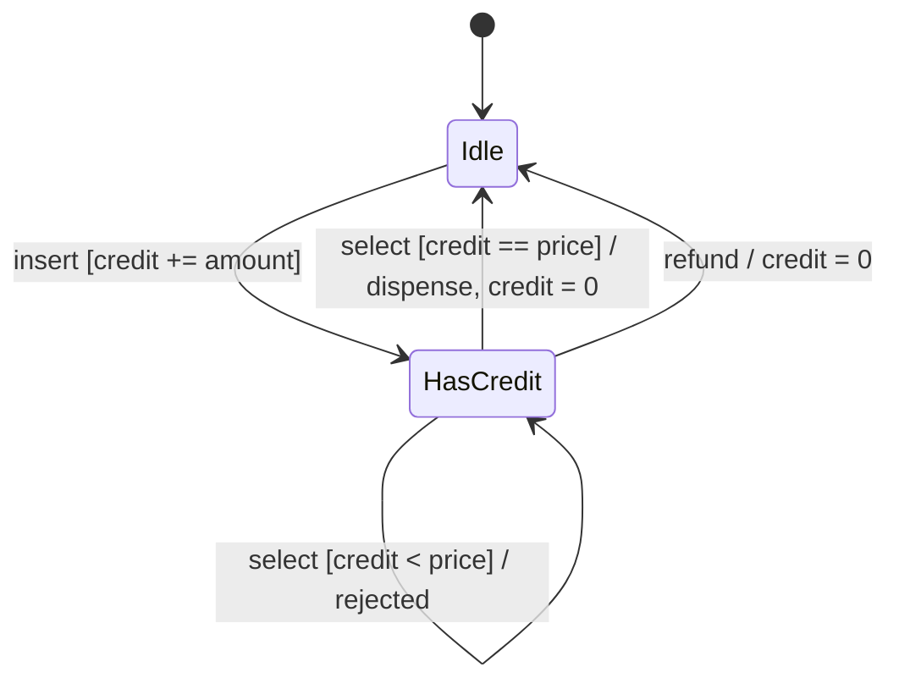

# Extended FSM (guards + context)

Adds context variables, guard conditions on transitions and actions that update the context. The state set stays small while behaviour depends on data.

## Use case
Vending machine with `credit` (cents) and a fixed `price = 75`.

| From | Event | Guard | Action | To |
|------|-------|-------|--------|----|
| Idle | insert(amount) | amount > 0 | credit += amount | HasCredit |
| HasCredit | insert(amount) | amount > 0 | credit += amount | HasCredit |
| HasCredit | select | credit >= price | credit -= price; dispense | Idle if credit == 0 else HasCredit |
| HasCredit | select | credit < price | none | HasCredit |
| HasCredit | refund | — | credit = 0 | Idle |

## In XState
Machine: [`vendingMachine.machine.ts`](../../xstate/src/machines/vendingMachine.machine.ts) (vendingMachine). Scenario tests: [`designs.unit.test.ts`](../../xstate/test/designs.unit.test.ts). Guard blocks under-funded purchase; change retained after purchase; refund zeroes credit. Checked (bounded, 4 events deep, coins 0/25/50/100): credit never negative, idle means no credit, `has_credit` means credit > 0.

## In Python
[`vending_machine.py`](../../src/petrilab/fsm/vending_machine.py) builds the same machine on the generic engine [`efsm.py`](../../src/petrilab/fsm/efsm.py) (same state ids, context names and transition order). [`test_vending_machine.py`](../../tests/fsm/test_vending_machine.py) replays all 129 XState vectors and checks that the Python explorer finds the same 53 configurations and 129 edges at depth 4. Formal treatment and a hand-worked run: [efsm-formal.md](efsm-formal.md).
