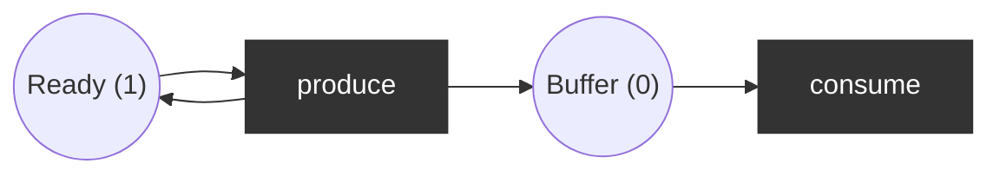

# Coverability graph (Karp-Miller)

The reachability graph of an unbounded net is infinite, so plain exploration never stops. The **coverability graph** is always finite and still answers boundedness and coverability exactly. Prerequisite: [foundations.md](foundations.md).

## Definitions

- Extend ℕ with **ω** ("arbitrarily many"): `ω > n`, `ω + n = ω − n = ω` for every `n ∈ ℕ`.
- An **ω-marking** maps places to `ℕ ∪ {ω}`. Enabling and firing work as before with this arithmetic.
- `M ≤ M'` iff `M(p) ≤ M'(p)` for every place; `M < M'` iff `M ≤ M'` and `M ≠ M'`.

**Key observation (monotonicity).** If `M[σ⟩M'` and `M < M'`, then `σ` is enabled again in `M'` (it has at least the tokens it had in `M`) and leads to `M' + (M' − M)`. Repeating it pumps every place where `M'(p) > M(p)` without bound. So those places can be replaced by ω.

## Algorithm (Karp and Miller 1969)

```
root := M0
work := [root]
while work not empty:
    take node n with marking M
    if M was already expanded: mark n as duplicate, continue
    for every t enabled in M:
        M' := fire(M, t)
        for every ancestor a of n'  (on the path root .. n, including n):
            if a.M < M':  M'(p) := ω for every p with a.M(p) < M'(p)
        add child n' with marking M', edge n --t--> n'; push n'
```

Termination: on every infinite path some marking would cover an earlier one (Dickson's lemma), which is exactly when ω is introduced, and ω entries never go away. Merging nodes with equal ω-markings turns the tree into a graph; this repo does that ([`coverability.py`](../../src/petrilab/petri/coverability.py)).

## What it answers

| Question | Answer from the coverability graph |
|----------|------------------------------------|
| Bounded? | iff no ω appears |
| Bound of place p | max of `M(p)` over the nodes (or ω) |
| Is M coverable? | iff some node `M' ≥ M` |
| Can t ever fire (L1)? | iff t labels some edge |
| Is M reachable? | **not decidable from it** in general: ω forgets exact counts |
| Deadlock-free / live? | **not decidable from it** in general; for bounded nets the coverability graph *is* the reachability graph |

Inhibitor arcs break monotonicity (more tokens can disable a transition), so the construction is unsound for them; the code rejects such nets.

## Worked example: producer without capacity



Place order `(Ready, Buffer)`, `M0 = (1, 0)`.

1. Root `(1, 0)`. Enabled: `produce` only (`consume` needs `Buffer ≥ 1`).
2. `produce` gives `(1, 1)`. Ancestor `(1, 0) < (1, 1)` and `Buffer` grew, so the new node is `(1, ω)`.
3. Expand `(1, ω)`: `produce` gives `(1, ω + 1) = (1, ω)`; `consume` gives `(1, ω − 1) = (1, ω)`. Both lead back to the same node: two self-loops.

Result: 2 nodes, `Buffer` unbounded, `Ready` bounded by 1. `{Buffer: 1000}` is coverable; `{Ready: 2}` is not.

Adding a capacity place `Free` (initially `k`), consumed by `produce` and produced by `consume`, gives the bounded [producer/consumer](foundations.md) (worked example, section 6): the coverability graph then has no ω and equals the reachability graph.

```python
from petrilab.petri.coverability import coverability_graph, format_marking

cg = coverability_graph(net)
sorted(format_marking(m) for m in cg.markings)  # ['(1, 0)', '(1, ω)']
cg.unbounded_places()  # ['Buffer']
```

Runnable: `uv run python examples/coverability_unbounded.py`. Tests: [`tests/petri/test_coverability.py`](../../tests/petri/test_coverability.py).
