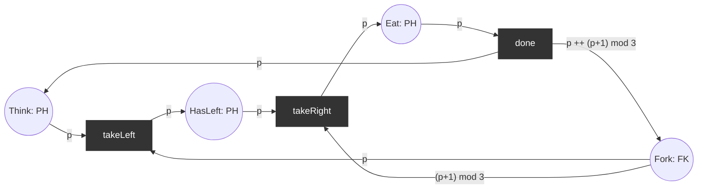

# Coloured Petri nets (formal)

A coloured Petri net (CPN) is a P/T net whose tokens carry data values ("colours"). Places are typed, arcs carry expressions and transitions carry guards. One CPN place often replaces a whole family of P/T places. Prerequisite: [foundations.md](foundations.md). A first informal example: [colored.md](colored.md).

Definitions follow Jensen and Kristensen (2009), *Coloured Petri Nets: Modelling and Validation of Concurrent Systems*, ch. 4 ([references](../references.md)).

## 1. Multisets

A **multiset** over a set `S` is a function `m : S → ℕ`. Notation (CPN Tools): `2`a ++ 1`b` means two `a` and one `b`; the engine prints it `{2`'a', 'b'}`.

| Operation | Definition |
|-----------|-----------|
| `m1 ++ m2` | `(m1 ++ m2)(s) = m1(s) + m2(s)` |
| `m1 <<= m2` | `m1(s) ≤ m2(s)` for all `s` |
| `m2 −− m1` (only if `m1 <<= m2`) | `(m2 −− m1)(s) = m2(s) − m1(s)` |
| `|m|` | `Σ_s m(s)` (size) |

In Python a multiset is a `collections.Counter`.

## 2. The net

A non-hierarchical CPN is a tuple `CPN = (P, T, A, Σ, V, C, G, E, I)`:

| Symbol | Meaning |
|--------|---------|
| `P`, `T` | finite, disjoint sets of places and transitions |
| `A ⊆ (P × T) ∪ (T × P)` | arcs |
| `Σ` | finite set of non-empty **colour sets** (types) |
| `V` | finite set of **typed variables**, `Type[v] ∈ Σ` |
| `C : P → Σ` | **colour set function**: the type of each place |
| `G : T → EXPR_V` | **guard**: Boolean expression over the variables of `t` |
| `E : A → EXPR_V` | **arc expression**: for arc `(p, t)` or `(t, p)`, an expression of type `C(p)_MS` (a multiset over `C(p)`) |
| `I : P → EXPR_∅` | **initialisation**: closed expression of type `C(p)_MS` |

`Var(t)` is the set of variables free in the guard of `t` and in the expressions on its arcs.

## 3. Enabling and occurrence

- A **binding** `b` of `t` assigns each `v ∈ Var(t)` a value `b(v) ∈ Type[v]`. `(t, b)` is a **binding element**.
- `expr⟨b⟩` is `expr` evaluated under `b`.
- `(t, b)` is **enabled** in marking `M` iff
  1. `G(t)⟨b⟩ = true`, and
  2. `E(p, t)⟨b⟩ <<= M(p)` for every place `p` (missing arcs evaluate to the empty multiset).
- Its **occurrence** gives `M'` with
  `M'(p) = (M(p) −− E(p, t)⟨b⟩) ++ E(t, p)⟨b⟩` for every `p`.

Every P/T notion carries over with binding elements in place of transitions: reachability graph (edges labelled `t⟨b⟩`), dead markings, boundedness (on multiset sizes), liveness.

## 4. Worked example: dining philosophers, folded

Three philosophers `PH = {0, 1, 2}`, three forks `FK = {0, 1, 2}`. Philosopher `p` uses left fork `p` and right fork `(p + 1) mod 3`. Variable `p : PH`.



Initial marking: `Think = Fork = 1`0 ++ 1`1 ++ 1`2`, `HasLeft = Eat = ∅`. No guards.

**Step 1.** Bindings of `takeLeft` in `M0`: `p ∈ {0, 1, 2}`. For `p = 1`: `E(Think, takeLeft)⟨p=1⟩ = 1`1 <<= M0(Think)` and `E(Fork, takeLeft)⟨p=1⟩ = 1`1 <<= M0(Fork)`: enabled. Same for 0 and 2.

**Step 2.** Fire `takeLeft⟨p=1⟩`:

| Place | before | −− in | ++ out | after |
|-------|--------|-------|--------|-------|
| Think | {0,1,2} | {1} | | {0,2} |
| Fork | {0,1,2} | {1} | | {0,2} |
| HasLeft | {} | | {1} | {1} |

**Step 3.** In `M1`, `takeRight⟨p=1⟩` needs `HasLeft ∋ 1` and `Fork ∋ (1+1) mod 3 = 2`: enabled. `takeLeft` is enabled for `p = 0` and `p = 2`. Firing `takeRight⟨p=1⟩` gives `Eat = {1}`, `Fork = {0}`, `Think = {0, 2}`.

**Step 4: the deadlock.** From `M0`, fire `takeLeft⟨p=0⟩ takeLeft⟨p=1⟩ takeLeft⟨p=2⟩`: `HasLeft = {0,1,2}`, `Fork = ∅`. Every `takeRight⟨p⟩` needs a fork, no `takeLeft` has a thinker: **dead marking**. Same state space as the P/T version: 14 markings, 27 edges, 1 dead marking for n = 3.

```python
from petrilab.petri import cpn_examples

net = cpn_examples.philosophers(3)
net.enabled_bindings(net.initial_marking, "takeLeft")  # [{'p': 0}, {'p': 1}, {'p': 2}]
net.trace_to(lambda m: not net.successors(m))
# ['takeLeft<p=0>', 'takeLeft<p=1>', 'takeLeft<p=2>']
```

## 5. Unfolding to a P/T net

Every CPN with finite colour sets has an equivalent P/T net:

- one P/T place `p[c]` for each place `p` and colour `c ∈ C(p)`;
- one P/T transition `t⟨b⟩` for each binding `b` with `G(t)⟨b⟩ = true`;
- `W(p[c], t⟨b⟩) = E(p, t)⟨b⟩(c)` and `W(t⟨b⟩, p[c]) = E(t, p)⟨b⟩(c)`.

The two reachability graphs are isomorphic, so P/T tools (invariants, coverability) apply to the unfolding. The price is size: `Σ_p |C(p)|` places and up to `Σ_t Π_{v ∈ Var(t)} |Type[v]|` transitions. The folded philosophers have 4 places and 3 transitions for any n; the unfolding has `4n` places and `3n` transitions.

```python
from petrilab.petri.cpn import unfold

pt = unfold(cpn_examples.philosophers(3))
len(pt.places), len(pt.transitions)  # (12, 9)
```

**Place invariants of a CPN** are weighted sums over (place, colour) pairs. For the philosophers, each fork `f` satisfies `Fork[f] + HasLeft[f] + Eat[f] + Eat[f−1] = 1`: it is on the table, held as a left fork by `f`, or used by an eating neighbour. Exercise [C3](../../exercises/cpn/c3-unfolding-invariants.md) derives it from the unfolding.

## 6. The Python engine and SNAKES

| | [`cpn.py`](../../src/petrilab/petri/cpn.py) (hand-written) | SNAKES ([`colored.py`](../../src/petrilab/petri/colored.py)) |
|--|--|--|
| Colour sets | finite `ColourSet`, checked on every arc | any Python value, unchecked |
| Bindings | enumerate the product of variable domains, filter by guard and tokens | pattern matching on input arcs |
| Arc expressions | Python callables `binding -> tokens` | `Variable`, `Expression`, `MultiArc`, ... |
| Unfolding | `unfold(cpn) -> PTNet` | not provided |
| Use it for | learning the definition, unfolding, invariants | larger nets, PNML |

Both agree on the [jobs net](colored.md) (4 markings, 1 dead marking); the folded philosophers and mutex agree with the P/T nets in [`examples.py`](../../src/petrilab/petri/examples.py) for every size tested ([`test_cpn.py`](../../tests/petri/test_cpn.py)).

## 7. Beyond this repo

- **Hierarchy**: substitution transitions and fusion places (Jensen and Kristensen, ch. 5); P/T analogue in [hierarchical.md](hierarchical.md).
- **Time**: timed CPNs with token time stamps (ch. 10); P/T analogue in [timed.md](timed.md).
- **CPN Tools** uses Standard ML for inscriptions and has a full state-space tool with strongly-connected-component reports.

Next: [EFSMs](../fsm/efsm-formal.md), which are CPNs with one token.
