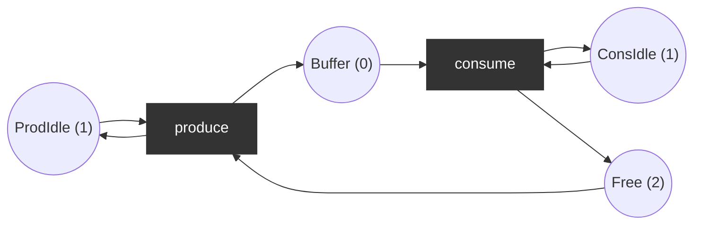

# Petri net foundations (formal)

The definitions every other Petri page builds on, with one example worked by hand and then checked in Python. Notation follows Murata (1989), the standard survey ([references](../references.md)).

## 1. The net

A **place/transition (P/T) net** is a tuple `N = (P, T, F, W, M0)`:

| Symbol | Meaning |
|--------|---------|
| `P = {p1, ..., pm}` | finite set of **places** (local states, buffers, resources) |
| `T = {t1, ..., tn}` | finite set of **transitions** (events), `P ∩ T = ∅`, `P ∪ T ≠ ∅` |
| `F ⊆ (P × T) ∪ (T × P)` | **arcs**: the net is a bipartite directed graph |
| `W : F → ℕ⁺` | arc **weights** (1 when not written) |
| `M0 : P → ℕ` | **initial marking**: tokens per place |

A marking is written as a vector over a fixed order of places, e.g. `M = (1, 2, 0, 1)`.

**Pre- and post-sets.** For a node `x`: `•x = {y | (y, x) ∈ F}` (inputs) and `x• = {y | (x, y) ∈ F}` (outputs).

**Pre and Post matrices.** `Pre[p, t] = W(p, t)` (0 if no arc), `Post[p, t] = W(t, p)`. The **incidence matrix** is `C = Post − Pre`, an `m × n` integer matrix; column `C[·, t]` is the net effect of firing `t`.

> A self-loop (`p ∈ •t ∩ t•`) cancels out in `C`. Two different nets can share an incidence matrix; any analysis based only on `C` cannot see self-loops. Nets without self-loops are called **pure**.

## 2. Firing rule

- `t` is **enabled** in `M`, written `M[t⟩`, iff `M(p) ≥ W(p, t)` for every `p ∈ •t`.
- Firing an enabled `t` gives `M'` with `M'(p) = M(p) − W(p, t) + W(t, p)`, written `M[t⟩M'`. In vector form: `M' = M + C·e_t`, where `e_t` is the unit vector of `t`.
- Firing is **atomic** and **non-deterministic**: when several transitions are enabled, any one may fire.
- A **firing sequence** `σ = t1 t2 ... tk` with `M0[t1⟩M1[t2⟩ ... [tk⟩Mk` is written `M0[σ⟩Mk`.

Extensions used elsewhere in this repo: inhibitor arcs (enabled only if `M(p) < w`) and read arcs (need tokens, do not consume): [inhibitor-read.md](inhibitor-read.md). Inhibitor arcs make the formalism Turing-complete, so most of the decidability results below no longer apply.

## 3. Reachability

- **Reachability set** `R(N, M0)`: every `M` with `M0[σ⟩M` for some `σ`.
- **Reachability graph**: nodes `R(N, M0)`, an edge `M --t--> M'` for every `M[t⟩M'`. Finite iff the net is bounded.
- **State equation**: if `M0[σ⟩M` then `M = M0 + C·σ⃗`, where `σ⃗ ∈ ℕⁿ` (the **Parikh vector**) counts how often each transition occurs in `σ`. The converse is false: an integer solution `σ⃗ ≥ 0` does not guarantee that a fireable ordering exists (see exercise [P6](../../exercises/petri/p6-state-equation.md)). So the state equation is a cheap *necessary* condition: no solution proves non-reachability.

## 4. Behavioural properties

| Property | Definition |
|----------|-----------|
| **k-bounded** | `M(p) ≤ k` for every `p` and every reachable `M`. **Bounded**: k-bounded for some k. |
| **Safe** | 1-bounded. |
| **Dead marking (deadlock)** | reachable `M` that enables no transition. **Deadlock-free**: no dead marking is reachable. |
| **Liveness of t** | L0 (dead): `t` never fires. L1: `t` fires in some firing sequence. L2: for every k, `t` can fire at least k times in some sequence. L3: `t` occurs infinitely often in some infinite sequence. L4 (**live**): `t` is L1-live in every reachable marking. |
| **Live net** | every transition is L4-live. Live ⇒ deadlock-free (converse false). |
| **Reversible** | `M0` is reachable from every reachable marking. |
| **Home state** | `Mh` reachable from every reachable marking. |
| **Coverable** | `M` is coverable if some reachable `M' ≥ M` (componentwise). Used for "can two processes be in the critical section?". |

On a finite reachability graph, all of these are graph algorithms: dead markings are nodes with out-degree 0; L4-liveness holds iff every terminal strongly connected component contains an edge for every transition ([`analysis.is_live`](../../src/petrilab/petri/analysis.py)). For unbounded nets use the coverability graph: [coverability.md](coverability.md).

## 5. Structural analysis: invariants

Structural results depend only on `C`, not on `M0`, and need no state-space exploration.

- **P-invariant** (place invariant): `y ∈ ℤᵐ`, `y ≠ 0`, with `yᵀ·C = 0`. Multiplying the state equation by `yᵀ`: `yᵀ·M = yᵀ·M0` for **every** reachable `M`. A weighted token sum is conserved.
- **T-invariant**: `x ∈ ℕⁿ`, `x ≠ 0`, with `C·x = 0`. A firing sequence with Parikh vector `x` (if one is fireable) returns to the marking it started from.
- If a P-invariant `y` has `y(p) > 0` for every place, the net is **structurally bounded**: `M(p) ≤ yᵀM0 / y(p)`.
- A bounded and live net is covered by T-invariants (every transition appears in some T-invariant).
- Invariants form a vector space (over ℚ): a basis is not unique, and a basis may contain negative entries even when a meaningful non-negative ("semi-positive") invariant exists. Combine basis vectors to find the one you want.

Implementation: [`invariants.py`](../../src/petrilab/petri/invariants.py) (sympy integer nullspace of `Cᵀ` and `C`).

## 6. Worked example: producer/consumer with a 2-slot buffer



Place order `(ProdIdle, Free, Buffer, ConsIdle)`, `M0 = (1, 2, 0, 1)`. Net: [`examples.producer_consumer(2)`](../../src/petrilab/petri/examples.py).

**Step 1: matrices.**

| | produce | consume |
|--|:--:|:--:|
| Pre | (1, 1, 0, 0) | (0, 0, 1, 1) |
| Post | (1, 0, 1, 0) | (0, 1, 0, 1) |
| C = Post − Pre | (0, −1, 1, 0) | (0, 1, −1, 0) |

`ProdIdle` and `ConsIdle` are self-loops: their rows in `C` are zero.

**Step 2: fire by hand.**

| Marking | Enabled | Why |
|---------|---------|-----|
| `M0 = (1, 2, 0, 1)` | produce | consume needs Buffer ≥ 1 |
| `M0 [produce⟩ M1 = (1, 1, 1, 1)` | produce, consume | both presets covered |
| `M1 [produce⟩ M2 = (1, 0, 2, 1)` | consume | produce needs Free ≥ 1 |

`M1 [consume⟩ M0` and `M2 [consume⟩ M1`. Reachability set: `{M0, M1, M2}`, 3 markings, 4 edges, no dead marking.

**Step 3: properties.**
- Bounded: `Buffer ≤ 2`, `Free ≤ 2`; not safe (2 tokens). Deadlock-free. Live (the graph is one strongly connected component and both transitions occur). Reversible.
- P-invariants: `y = (0, 1, 1, 0)` gives `Free + Buffer = 2`; `(1, 0, 0, 0)` gives `ProdIdle = 1`; `(0, 0, 0, 1)` gives `ConsIdle = 1`. Check: `yᵀ·C = (0·0 + 1·(−1) + 1·1 + 0, 0 + 1·1 + 1·(−1) + 0) = (0, 0)`.
- T-invariant: `x = (1, 1)`: produce once and consume once, the marking is unchanged.
- State equation for `M2`: `M2 − M0 = (0, −2, 2, 0) = C·(2, 0)`: two `produce`, zero `consume`.

**Step 4: check in Python** (`uv run python examples/pt_firing_and_invariants.py` prints this and more):

```python
from petrilab.petri import examples
from petrilab.petri.invariants import place_invariants, transition_invariants

net = examples.producer_consumer(2)
net.incidence()  # [[0, 0], [-1, 1], [1, -1], [0, 0]]
len(net.reachable())  # 3
place_invariants(net)  # [[1, 0, 0, 0], [0, 1, 1, 0], [0, 0, 0, 1]]
transition_invariants(net)  # [[1, 1]]
```

## 7. Subclasses worth knowing

| Class | Restriction | Why it matters |
|-------|-------------|----------------|
| State machine | every transition has exactly one input and one output place | equivalent to an FSM when it has one token |
| Marked graph | every place has exactly one input and one output transition | pure concurrency, no choice; liveness and boundedness decidable from cycles |
| Free-choice | if two transitions share an input place, they have the same preset | choice and concurrency do not interfere; rich theory (Desel and Esparza 1995) |
| Workflow net | one source place, one sink place, every node on a path between them | business processes; soundness: [workflow.md](workflow.md) |

## 8. Decidability, in one table

| Problem | Status for P/T nets |
|---------|---------------------|
| Boundedness, coverability | decidable (Karp-Miller 1969); EXPSPACE-complete (Lipton 1976, Rackoff 1978) |
| Reachability | decidable (Mayr 1981, Kosaraju 1982); Ackermann-complete (Czerwiński and Orlikowski 2021, Leroux 2021) |
| Liveness | decidable (reduces to reachability) |
| Anything, with inhibitor arcs | undecidable in general (two-counter machines) |

Practical consequence: explicit state-space exploration (this repo) works up to millions of states; beyond that, use symbolic or partial-order methods (TINA, LoLA) or the state equation as a filter.

Next: [coverability graph](coverability.md), then [coloured nets](cpn-formal.md).
